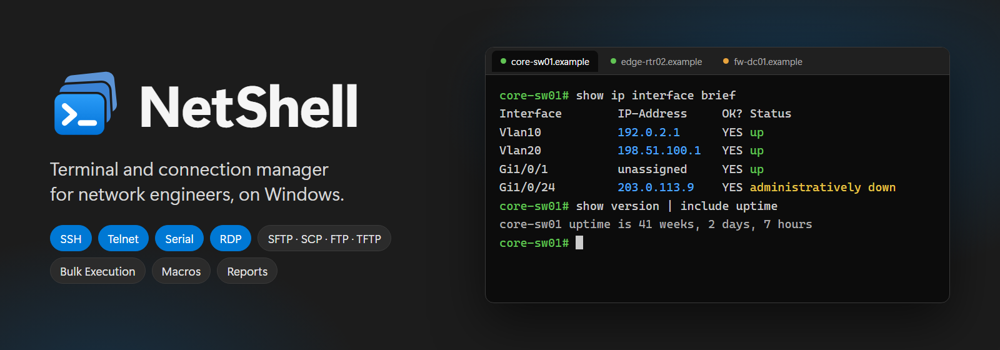

  

  
  
  
  
  

  <a href="../../releases/latest"><b>⬇️ Download the latest version</b></a> ·
  <a href="#features">Features</a> ·
  <a href="#install">Install</a> ·
  <a href="#security-and-updates">Security</a>

**NetShell** is a terminal and connection manager for **network engineers** on Windows. In one place you organize hundreds
of devices in folders and vaults, open SSH, Telnet, serial and RDP sessions in tabs, transfer files and run commands on many
devices at once, with ready-made reports. Its layout and terms follow Devolutions RDM and VanDyke SecureCRT, so anyone
coming from them feels at home.

<table>
  <tr>
    <td width="33%" valign="top">
      <h3>🗂️ Organized</h3>
      Devices in folders and vaults, with inherited credentials, proxies and terminal options. Imports from SecureCRT, PuTTY, RDM and CSV spreadsheets.
    </td>
    <td width="33%" valign="top">
      <h3>⚡ Automated</h3>
      Bulk Execution, macros, Jinja2 configuration templates and Markdown reports that become PDFs, without opening one session at a time.
    </td>
    <td width="33%" valign="top">
      <h3>🔒 Yours</h3>
      Runs on your PC, with no cloud and no account. Data stays in a local file, passwords are protected by Windows, and a portable version fits on a USB stick.
    </td>
  </tr>
</table>

## Features

| Feature | What it does |
|---|---|
| 🖥️ **Sessions in tabs** | SSH, Telnet, serial (COM), raw TCP, local shell (cmd/PowerShell) and an external SSH client (plink) for legacy algorithms. Tabs that split, undock into their own windows and gather in colored **Tab Groups**. |
| 🧭 **Vaults and folders** | Several vaults (one per customer) and a shared vault; folders that pass down credentials, proxies, terminal options and variables; session rules by name, address or device type. |
| 🔀 **Proxies and jump hosts** | SOCKS4/5, HTTP CONNECT and SSH hops in any order, also for RDP, websites and file transfers, with a local relay on loopback only. |
| 🪟 **Embedded RDP and websites** | Remote Desktop inside a tab that fits its size automatically; device web pages in a tab (WebView2), through the device's proxy. |
| 📁 **File transfer** | SFTP, SCP, FTP/FTPS and TFTP with a queue, resume and conflict handling; batch upload and download to many devices. |
| 🚀 **Bulk Execution** | The same commands on dozens of devices in parallel, clean output per device, run history, export and device facts (model, version). |
| ⌨️ **Macros and Broadcast** | Macros with `[[Name]]` inputs and hotkeys, post-login commands, typing into several tabs at once and a Command Repeater that highlights what changed. |
| 📊 **Reports and templates** | Markdown reports with per-device command blocks (tables, filters, fields) and PDF export; Jinja2 configuration templates with YAML/JSON variables. |
| 🔎 **A full terminal** | xterm emulation, 50,000 lines of history, find, keyword highlighting (SecureCRT keyword lists), links to the devices named in the output and safe paste. |
| 📜 **Logs and history** | Session logs with passwords removed, searchable log history, side-by-side log compare and the activity of each device on the Dashboard. |
| 🧰 **Network tools** | IP calculator, SSL toolkit (certificates and chains), network scan to add many devices at once. |
| 🎨 **Appearance** | Dark theme in the Windows grays, light and high contrast; eight accent colors; interface scale. |

## Install

### 💻 With the installer (Windows 10 or 11, 64-bit)

1. Open the [latest version](../../releases/latest) and download `NetShell-Setup-<version>.exe`.
2. Run it. NetShell installs for your user only (no administrator rights needed) and appears in the Start menu.

### 🎒 Portable (no installation)

1. Download `NetShell-<version>-win-x64-portable.zip`, open the file's **Properties** and check **Unblock**.
2. Extract it to a folder of your own (Documents, another drive or a USB stick) and run `NetShell.exe` inside `NetShell-win-x64-self-contained`.
3. Your data stays in the `Data` folder next to the program: deleting the folder removes everything.

> The program is not code-signed yet. If Windows shows "Windows protected your PC", click **More info › Run anyway**.

## Security and updates

- **Protected passwords:** passwords, private keys and passphrases are encrypted with Windows DPAPI, tied to your Windows user. Saved passwords show as dots, and the eye of a password field reveals one only after Windows Hello. Session logs remove what you type as a password, and an export can be encrypted with a password.
- **One-click updates:** in **Help › About › Check for Updates** NetShell tells you when a new version is out, downloads it, checks its **SHA-256** (GitHub's digest and `SHA256SUMS.txt`) and restarts on its own. This works for the **portable** version too: the program files are replaced, and if the new version does not start, the folder goes back to the previous one by itself. The `Data` and `Logs` folders are never touched.
- **Backups:** an automatic daily backup of the data file, and a backup before every import and every upgrade of the file.
- **Manual check:** every version has a `SHA256SUMS.txt` with the SHA-256 of all its files. See [all versions](../../releases).

---

This repository holds only the published versions; the source code is not public. © vicentenetwork-sys. All rights reserved.
